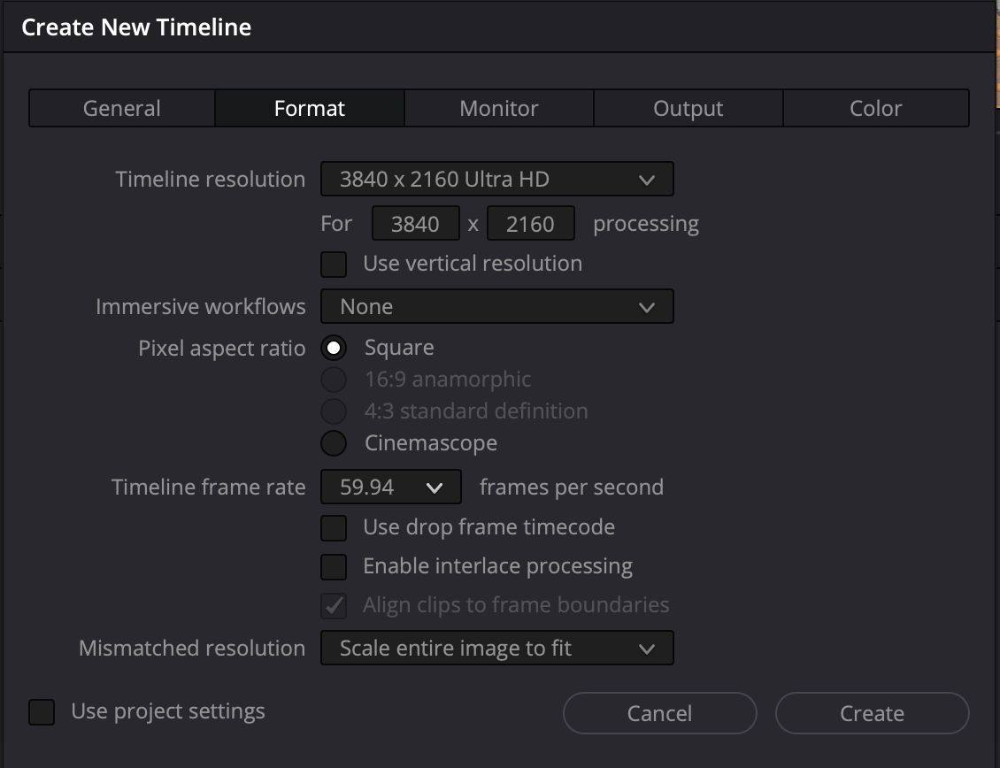
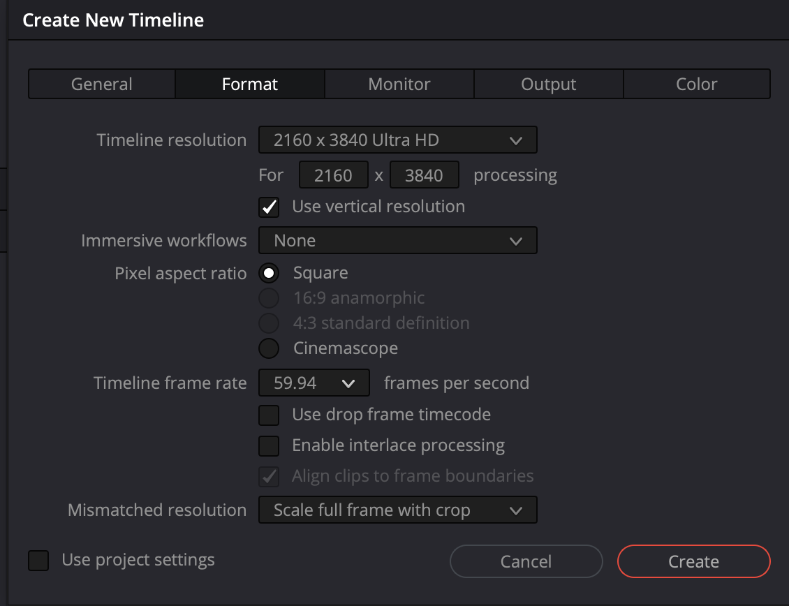

# Set up Resolve manually

Recipe resolve-multicamera-hdr 0.1.0. This is a supported reading path without Kestreel. The JSON files provide configuration for the Kestreel foundation adapter. It creates empty timelines and verifies supported settings; plugin setup and color-transform nodes remain manual. PDFs accompany these instructions as a portable reference.

Source -> camera geometry and input normalization -> DWG/Intermediate -> grade -> PQ or HLG output transform -> encode and verify.

## 1. Files and dependencies
Create a project folder with manifests, workspace/resolve, workspace/intermediates, masters and deliveries. Keep originals separately under YYYY/YYYY-MM/YYYY-MM-DD; retain companions and a verified ingest manifest. Device identity belongs to Kairo, ingestion to Kestreel. Do not rewrite originals to add authorship: use sidecars. Use local SSD cache when useful; a network share is not a substitute for backup.

Install Resolve and each required dependency from resources/dependencies. Record exact versions. Restart Resolve after OFX installation. Paid LUTs and plugin installers remain local under awara-private; public recipes provide links only.

## 2. Resolve project
Create a new project in your Resolve project library. Media Location is not the project database location. Export a .drp snapshot to workspace/resolve at checkpoints; it does not contain source media, plugins or licensed LUTs.

Before creating the timeline choose frame rate to suit the delivery/source (the Action 6 test used 59.94; Osmo 360 used 29.97). Choose the required raster, not a universal square master. In Project Settings > Color Management select DaVinci YRGB, timeline DaVinci WG/Intermediate, no project input/output LUT, and Tetrahedral LUT interpolation. Select the output declaration for the branch being rendered: Rec.2100 ST2084 or Rec.2100 HLG. This declares interpretation; manual YRGB still needs explicit pixel transforms.

Color-managed YRGB can automate supported input/output conversions. This recipe deliberately uses manual YRGB to make plugin and LUT responsibilities explicit. Do not switch modes without redesigning the input/output chain.

### Gyroflow: recheck scaling after selecting vertical resolution

Observed in the Resolve Studio 21.1.2.10 lab on 2026-11-01: enabling **Use vertical resolution** in Create New Timeline changed **Mismatched resolution** from **Scale entire image to fit** to **Scale full frame with crop**. The screenshots below record the before/after states; the intervening action was reported by the user. Do not assume all Resolve versions behave identically or infer the reason for this UI behavior.

For the Action 6/Gyroflow workflow:

1. Disable **Use project settings** when creating a source-processing timeline that needs independent settings.
2. Choose the desired resolution/orientation and source frame rate first (59.94 fps for the tested Action 6 clip).
3. **After enabling Use vertical resolution**, explicitly set **Mismatched resolution → Scale entire image to fit** again.
4. Create the timeline, reopen Timeline Settings, and verify both frame rate and scaling before loading Gyroflow.
5. Recheck scaling whenever changing the timeline's aspect ratio. Review the stabilized framing and an exported motion sample; Status OK alone is not a motion-quality check.

The square 3840×3840 source differs in aspect ratio from both 3840×2160 landscape and 2160×3840 portrait timelines. Gyroflow's [official different-aspect-ratio guidance](https://docs.gyroflow.xyz/video-editor-plugins/davinci-resolve-openfx) specifies Scale entire image to fit. This setting is a prerequisite, not a complete portrait reframing or resolution-preservation recipe; the same guidance describes the Fusion/output-size route for that purpose.

**Kestreel implementation requirement:** set resolution/orientation first, apply fit scaling afterward, and verify the effective timeline settings after creation. Do not rely solely on project defaults or a successful setting-write return value. This is a requirement for the adapter, not a claim that the safeguard is already implemented.

The earlier playback/stabilization problem improved after several settings and timeline changes. This observation identifies a required scaling check; it does not independently establish the cause of that earlier problem.

## 3. Action 6
Use camera-original D-Log M; Rec.709 container tags do not define its transfer function. For the tested post-stabilization workflow use Wide with RockSteady off. Preserve motion metadata. Apply Gyroflow on the Edit clip, Load for current file, and check Status OK, camera motion and matching lens profile. Lens correction 100 performs dewarp; do not stack an unrelated second dewarp. See the action6 profile for the baseline controls. RockSteady-on footage is already stabilized; do not assume it contains usable post-stabilization metadata.

Purchase the Gamut Action 6 DWG BaseLUT using resources/dependencies/gamut-action6.json. Preserve its vendor original. In Project Settings > Color Management > Open LUT Folder, install a copy as DJI/DJI_Action6_DLogM_to_DWG_Intermediate.cube, then Update Lists. This is a local filename convention, not a DJI-manufactured LUT. Existing projects using the old filename must be reassigned. Use the DWG variant, not Rec.709 or ARRI709.

On Color, apply that LUT once on the first clip node (or Group Pre-Clip for matching clips). Follow it with a neutral Grade node. Never apply it both places. Do not assign the Action 6 LUT to Osmo 360.

## 4. Osmo 360
Keep the OSV. Use Spatial Film OSV Converter to make the importable MP4 twin in workspace/intermediates. The tested twin was byte-identical; verify rather than assuming every conversion is lossless. Import the MP4; fisheyes before the plugin are expected. Place the clip on a timeline. In Edit apply Spatial Film DJI 360 Reframe, open Inspector > Effects > Open FX, and use the osmo360 profile settings. Select Color = DaVinci Wide Gamut/Intermediate. The plugin handles input conversion, stitching, geometry and its stabilization controls; do not add a D-Log M input LUT afterward.

Set Pan Angle keyframes at the beginning and later in the clip, such as 0 and 180 degrees for the test. Keep Tilt/Roll at zero initially. Check intermediate frames, horizon, seam and turn direction. Lens Curve changes projection appearance; it is not a color control. Disable the plugin Proxy checkbox before final export. See the detailed Osmo 360 reference for the tested settings.

## 5. Grade and output
Grade normalized clips in DWG/Intermediate. Camera normalization does not automatically match exposure or white balance. For a single-clip test, use input (if needed), Grade, Output nodes. For a mixed timeline use camera-specific inputs, clip grades, then one final timeline output CST. Avoid simultaneous clip and timeline output transforms.

Apply the selected applications/resolve/delivery JSON settings to the output CST. PQ uses DWG/I -> Rec.2020/ST2084, DaVinci tone mapping and custom maximum output 1000 nits. HLG uses DWG/I -> Rec.2100/Rec.2100 HLG; the recorded Action 6 test used tone mapping None. None requires deliberate control of highlights; it is not an automatic gamut or peak safeguard. Both tests used gamut mapping None, which needs review on new content. The project 1000-nit mastering declaration alone does not limit pixels.

Create separate delivery timelines/settings for PQ and HLG. Do not simply retag PQ as HLG. Duplicate timelines do not provide automatic editorial inheritance. Shared grades and variant synchronization remain a separate development task; preserve independent framing decisions.

## 6. Monitor, render and verify
For the tested Mac/XDR path enable Resolve 10-bit viewers and Mac display color profiles. Use HDR Video (P3-ST 2084) reference mode; disable automatic brightness and True Tone. Monitor P3 does not change Rec.2020 delivery primaries. A screenshot is not a luminance measurement.

Deliver > Custom Export: set a distinct filename and masters/deliveries destination, Single clip, QuickTime, H.265, Main10, chosen timeline raster/frame rate, Video levels, and explicit matching Rec.2020 + ST2084 or HLG tags. Turn off optimized/proxy/cached media for the verification render. Turn off Spatial Film Proxy too. Add to Render Queue and Render All.

Inspect exported metadata and decode the whole file; compare playback on a suitable display. Check duration, framing animation, seams and stability. PQ tags do not prove full HDR10 metadata. Mastering-display/MaxCLL/MaxFALL and platform upload verification are pending; do not invent measurements. The guide records practical visual acceptance, not independent colorimetric accuracy.

## Acceptance and portability
Record source hashes, dependency versions, recipe commit, actual settings and deviations in manifests. Save the project and export a fresh .drp. Reopen it and check media/plugin/LUT availability. Repeat on another machine before claiming portability. Keep paid assets in your own private storage; each user obtains their dependencies from the vendors.

## Project library and thumbnail housekeeping

Kestreel can list Resolve projects and export explicitly selected projects before removing their library entries. Private recovery exports may contain licensed LUTs and stills; do not publish them. Original media remains in its ingest location.

To refresh a project preview: open the Project Manager using the Home button, right-click the project tile, and choose **Update Thumbnails**. This refreshes Resolve-generated previews; it is not an arbitrary cover-image upload. The installed Resolve 21.1 scripting SDK has no documented project-thumbnail setter, so Kestreel does not automate a custom cover.

Reference: Blackmagic Design, DaVinci Resolve 18 Beginner's Guide, Project Manager contextual menu: https://documents.blackmagicdesign.com/UserManuals/DaVinci-Resolve-18-Beginners-Guide.pdf

If a missing-plugin warning appears after exporting a retired test project, dismiss it and open the active sample explicitly. Do not reinstall retired plugins merely to suppress an old project's warning. If the warning repeats when loading the active sample, inspect that project's effects and nested timelines before changing it. The Awara sample export inspected on 2026-11-01 contained no retired generator identifier.

## Generated preparation sample — 2026-11-01

The `applications/resolve/automation/hlg-preparation.json` recipe was exercised
through Kestreel against Resolve Studio 21.1.2.10. Save/reopen readback verified:

| Scope | FPS | Resolution |
|---|---|---|
| Project defaults | 23.976 (playback also 23.976) | 3840×2160 |
| PREP - Action 6 - Gyroflow - 59.94 | 59.94 | 3840×3840 |
| PREP - Osmo 360 - Spatial Film - 29.97 | 29.97 | 3840×2160 |
| EDIT - Main - 23.976 | 23.976 | 3840×2160 |

All three timelines were verified empty, with custom settings and Scale entire
image to fit. Project color science is manual DaVinci YRGB, working space
DaVinci WG/Intermediate, output declaration Rec.2100 HLG. These declarations
do not apply input LUTs, grades or the output CST. The Action 6 source is in the
Media Pool; OSV source preparation and import of the verified MP4 twin remain
manual. The project references originals; no stabilized intermediate was rendered.

The adapter uses supported empty FCP XML interchange because CreateEmptyTimeline
has no FPS parameter and the tested build rejected changing FPS afterward.
After enabling custom timeline settings it restores project defaults and verifies
each timeline again. The direct project playback-FPS setter was rejected during
experiments; importing the 23.976 editorial timeline established the correct
playback value in this successful run. Future runs must inspect readback and
flag any remaining mismatch. This test verifies scaffolding, not processing
quality or automatic inheritance between preparation and editorial timelines.
